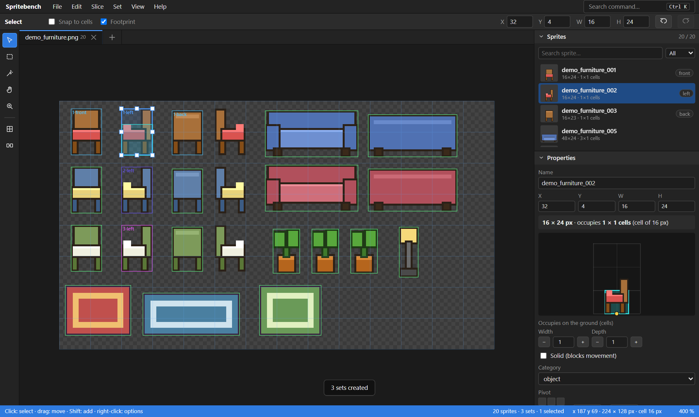
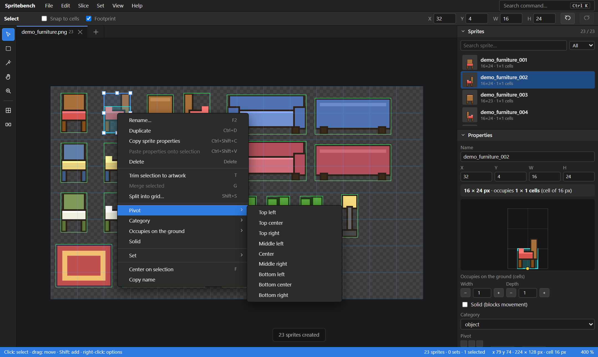
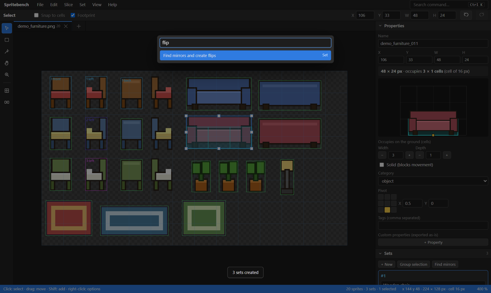
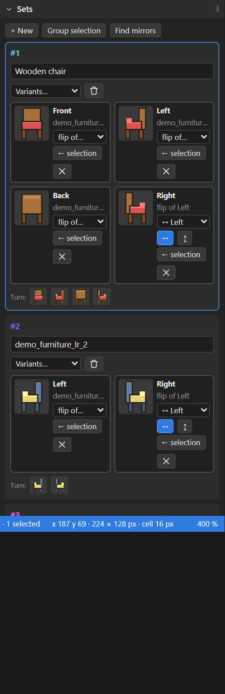
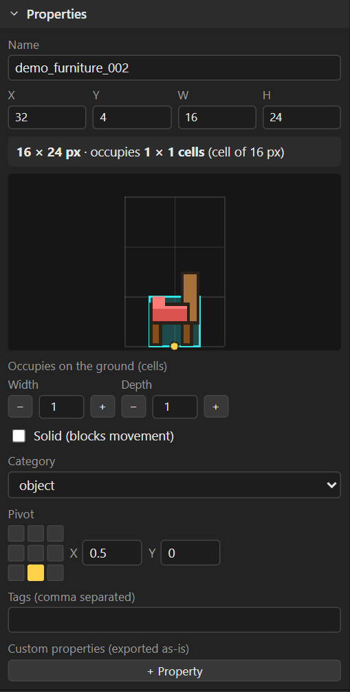
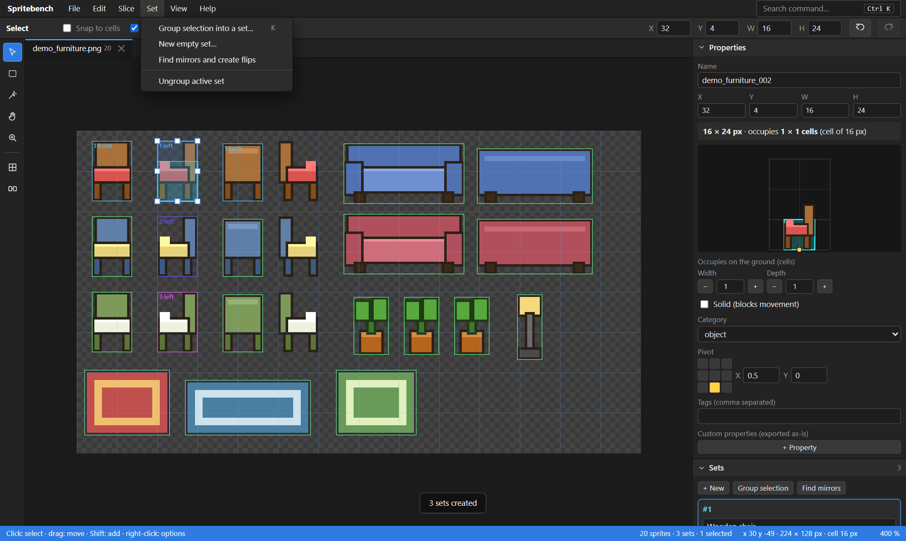

# Spritebench

**Catalog sprite sheets in minutes: slice them, group them into sets, link flipped variants, measure the grid footprint and export to Unity (or any engine).**

Spritebench is a free, offline-first sprite cataloguer that runs entirely in your browser — no install, no account, nothing is uploaded. It was born while building a furniture system for a house-builder game, where one couch drawn facing *left* also has to serve as the one facing *right* (flipped), and every piece needs to say how many grid cells it occupies and where it is placed.

> 🇲🇽 [Léeme en español](README.es.md)

**▶ Try it:** <https://luisaldrichguz.github.io/spritebench/> · or open `index.html` locally (double-click, no server needed).



<p align="center"> </p>
<p align="center">  </p>

## Why

Sprite sheets rarely arrive as one-file-per-sprite. To use them in a game you usually need to:

1. cut every object out of the sheet (and not cut it badly),
2. say which sprites are the *same object seen from different sides*,
3. avoid drawing the right side twice when it is the left one mirrored,
4. tell the game how big the object is on your grid and where its pivot is,
5. get all of that into your engine without hand-typing hundreds of rows.

Spritebench does exactly that, with an interface modelled on the design apps you already know (menu bar, tool bar, options bar, collapsible panels, right-click everywhere, undo history, command palette).

## Features

| | |
|---|---|
| **Slicing** | Auto-slice by transparency (with a "join pieces closer than N px" gap), grid slice with offset/spacing/trim, magic wand, free rectangle, trim-to-artwork, merge, split into grid |
| **Sets** | One object = one set with named variants (front / left / back / right, 8 directions, states, or your own). Variants can be **a flipped copy of another variant** (horizontal and/or vertical) so you never duplicate art |
| **Mirror finder** | Detects sprites that are exact mirrors of each other and replaces the duplicate with a flip link |
| **Grid footprint** | Per-sprite footprint in game cells (cols × rows), solid flag, pivot (9-point widget + free values) and a live **placement preview** showing how the piece sits on the grid |
| **Metadata** | Category, tags and free key/value properties exported with each sprite |
| **Editing** | Move/resize with handles, nudge with arrows, bulk rename with patterns, multi-select, marquee, search/filter, 100-step undo with a History panel |
| **Adobe-style UI** | Menu bar, options bar that changes with the tool, tool bar, tabs per sheet, accordion panels, status bar, context menus on sprites / canvas / lists / slots, `Ctrl+K` command palette, full keyboard shortcuts |
| **Export** | Catalog JSON (documented), TexturePacker-style atlas JSON, one PNG per sprite (optionally with flips baked in), `.zip` bundle or write straight into a folder (Chrome/Edge) |
| **Unity package** | One-click importer: slices the PNG with pivots, keeps sprite GUIDs stable on re-import and builds a ScriptableObject with sets, flips, footprints and properties, plus a runtime API (`Apply`, `NextVariant`, …) |
| **Safe** | Autosaves to your browser (IndexedDB); saves `.spritebench` project files; everything stays on your machine |

## Quick start (2 minutes)

1. Open Spritebench and drop a PNG sprite sheet on the window (or *File ▸ Load example sheet*).
2. **Slice ▸ Auto-slice** (or draw with **M**, click objects with the wand **W**, or **Slice ▸ Slice by grid**).
3. Click a sprite: set how many **cells it occupies**, its **pivot**, whether it is **solid**.
4. Select the sprites that are the same object from different sides → **K** (*Group into set*). Fill in *front / left / back / right*. For the missing side pick **“flip of…”** on the slot — or let **Set ▸ Find mirrors** do it for you.
5. **File ▸ Export bundle** → import into your engine. For Unity: see [docs/UNITY.md](docs/UNITY.md).

Full walkthrough with every tool and shortcut: **[docs/USAGE.md](docs/USAGE.md)**. File format: **[docs/FORMAT.md](docs/FORMAT.md)**.

## Keyboard cheat-sheet

| | | | |
|---|---|---|---|
| `V` select | `M` rectangle | `W` magic wand | `H` hand · `Z` zoom |
| `T` trim to artwork | `G` merge | `Shift+G` slice by grid | `Shift+S` split into grid |
| `K` group into set | `L` select loose | `F` focus selection | `0` fit · `1` 100 % · `4` 400 % |
| `Ctrl+Z` / `Ctrl+Shift+Z` | `Ctrl+D` duplicate | `Del` delete | `F2` rename |
| `Ctrl+S` save project | `Ctrl+E` export | `Ctrl+K` command palette | `F1` all shortcuts |

Mouse: wheel = zoom, `Space`+drag or middle button = pan, right click = context menu, `Shift`+click = add to selection, arrows = nudge (`Shift` = 10 px).

## Run it yourself

No build step. It is plain HTML + JavaScript:

```bash
git clone https://github.com/LuisAldrichGuz/spritebench.git
cd spritebench
# just open index.html, or serve the folder:
python -m http.server 8000     # then visit http://localhost:8000
```

Tests: open `tests/index.html` in a browser (13 logic checks), or run the real-mouse end-to-end suite that also regenerates the screenshots:

```bash
pip install playwright && playwright install chromium
python serve.py 8788 &
python scripts/e2e_and_screenshots.py http://127.0.0.1:8788
```

## Unity

Install the package with *Window ▸ Package Manager ▸ + ▸ Add package from git URL…*:

```
https://github.com/LuisAldrichGuz/spritebench.git?path=/unity
```

Then export from Spritebench into your `Assets/` folder and choose *Assets ▸ Spritebench ▸ Import catalog* on the `.catalog.json` (or enable auto-import). Details in [docs/UNITY.md](docs/UNITY.md).

## Roadmap

- More UI languages (English and Spanish ship today; add one by extending `js/i18n.js`).
- Godot and Defold importers (the atlas JSON already loads in Phaser/Pixi/libGDX).
- Animation strips (frame sequences) and per-sprite collision polygons.
- Per-set "rotation preview" playback.

Contributions welcome — see [CONTRIBUTING.md](CONTRIBUTING.md).

## License

MIT © Luis Aldrich Guzmán. Spritebench ships no third-party art; the demo sheet is generated by code.
